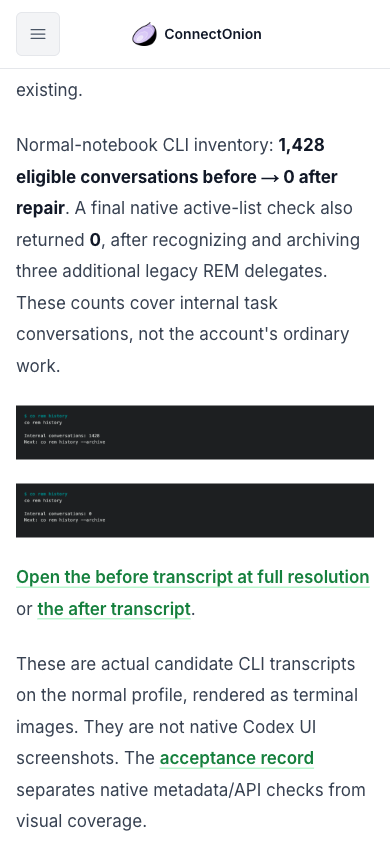
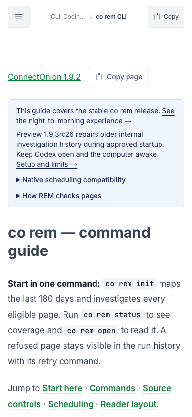

# RC26 documentation acceptance

Candidate source: `openonion/connectonion` commit `4ac7f8ad057b15832e5d6e210227e828dfda7be1`.
PyPI and GitHub publication passed the immutable-tag Trusted Publishing workflow
[40682710029](https://github.com/openonion/connectonion/actions/runs/40682710029),
reviewed merge `87d9bac2768b39b4c5404e8cd32f3c1c57a672a5`. GitHub and PyPI serve
byte-identical wheel/sdist files, whose contents match the local reviewed build.
Stable/default stays 1.9.2. Published-tag synchronization added the historical
rc24/rc25 notes. Production deployment checks remain required after final CI.

The normal machine installed public rc26 on Python 3.12.10. Both Codex and Claude
have all 44 skill entries available: 43 current managed links plus the existing
personal `handoff` override retained. Both command indexes are current; profile
fields and manual instructions outside generated blocks passed preservation
checks. The normal Codex App/profile was retained.

The actual loopback build was inspected at 390×844 and 1440×1080. Eighteen
captured views cover init, setup, create, skills, REM, email, release channels,
RC26 notes and the design journal. REM includes collapsed default and expanded
native-compatibility states; notes include the evidence section. Six raw CLI
guides match source bytes. Real clipboard and download readbacks are checked
separately with instrumented Chrome; layout captures use the shared co browser
in an owned leased tab. No shared login or unrelated tabs were changed.

## Independent AI founder / marketing / UI review

The reviewer inspected all four actual terminal images and the first seventeen
web captures. No human founder participation is claimed.

- **P2, mobile evidence:** scaled terminal text was too small. User impact:
  the result could not be understood without zoom. The release note now gives
  visible before/after counts and full-resolution transcript links. Recheck:
  the counts and original links are readable at 390px.
- **Default hierarchy:** the first compatibility screenshot was explicitly
  expanded for QA. Source and rebuilt default confirm it starts collapsed;
  the reviewer withdrew the default-state finding. Recheck both states.
- Source/runtime review separately closed protected-descendant and partial
  receipt gaps, with 32 independent source-only reproductions passing.

The independent reviewer inspected all 18 final candidate captures and found no
remaining blocking P1/P2 findings in that scope. Historical-note and public
postdeployment results are recorded in the PR. These are sample coverage, not an all-page or native-App UI pass.
Native/remote UI, every breakpoint, screen-reader behavior, live account-managed
registration and machine restart recovery remain outside this visual review.

